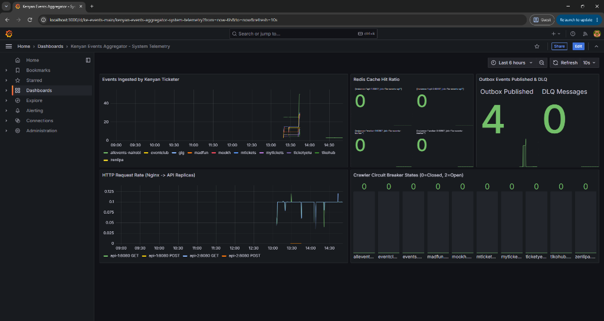

# kenya-events-aggregator

A headless, distributed **Kenyan Event Aggregation Service** written in **Go** (zero JavaScript), built to discover, normalize, deduplicate, and stream events from public Kenyan ticketing platforms.

Out of the box, it ships with **10 live Kenyan ticketer adapters** (pulling real events across Kenya), plus a generic endpoint ingestor so you can plug in any public JSON/REST/JSON-LD event feed and have it normalized into a single canonical schema.

---

## How It Works

```
  [10+ Kenyan Ticketers & Custom Endpoints]
                     │
        (Consistent-Hash Sharded Workers)
                     │
      ┌──────────────┴──────────────┐
      ▼                             ▼
[Media Mirror]              [Normalizer & Validator]
SeaweedFS S3                47 Kenyan Counties + Schema
(SHA-256 Dedup)             Content-Hash / Trigram Merge
                                    │
                            [PostgreSQL Primary]
                            (ACID + Transactional Outbox)
                                    │
                    ┌───────────────┼───────────────┐
                    ▼               ▼               ▼
             [PG Read Replica]  [Redpanda/Kafka]  [Redis]
             (WAL Streaming)    (topics + DLQ)    (Cache-Aside, Locks,
                                                  Rate Limit, Pub/Sub)
                                    │
                        [Nginx L7 Load Balancer]
                         ├── api-1 / api-2 (Go)
                         ├── REST + OpenAPI (/api/v1/...)
                         ├── GraphQL (/graphql)
                         ├── gRPC (:50051)
                         ├── SSE (/api/v1/stream) & WS (/api/v1/ws)
                         └── URL Shortener (/e/{code})
```

1. **Discovery & Sharded Crawling:** `worker-1` and `worker-2` use a **Consistent Hash Ring** + **Redis Distributed Locks** so each Kenyan ticketer domain is crawled by one worker at a time without duplicate work.
2. **Resilience:** Every external ticketer is wrapped in a **Circuit Breaker**, **Exponential Backoff with Jitter**, and a **Bulkhead** concurrency cap.
3. **Strict Kenyan Event Schema & Deduplication:** Events are validated against all **47 Kenyan counties**, `main_photo` + up to 4 `photos`, `ticket_tiers` (name, price, currency, conditions, benefits), single/multi-day `schedules`, and optional `google_maps_link`, `itinerary`, and `what_to_expect`. Duplicate events across different ticketers are merged via `content_hash` and `pg_trgm` title similarity.
4. **Media Mirroring:** Posters are downloaded (with **SSRF protection**), deduplicated by `SHA-256`, and stored in **SeaweedFS S3** so external link rot or expiring signed URLs never break your frontend.
5. **Event Emission:** Every saved event writes to `outbox_events` in the same PostgreSQL transaction (**Transactional Outbox Pattern**). An outbox relay publishes to **Redpanda/Kafka** (`events.discovered`) and **Redis Pub/Sub**, fanning out to **SSE**, **WebSockets**, **gRPC streams**, and **HMAC-SHA256 signed Webhooks** (with **DLQ** fallback on `events.dlq`).

---

## Seeded Kenyan Ticketer Sources (10 Live Adapters)

- `mytickets.africa` (`jsonld_sitemap`)
- `ticketyetu.com` (`jsonld_sitemap`)
- `eventclub.co.ke` (`jsonld_listing_links`)
- `events.gig.co.ke` (`jsonld_listing_links`)
- `madfun.com` (`jsonld_sitemap`)
- `allevents.in/nairobi` (`jsonld_listing`)
- `zenlipa.co.ke` (`jsonld_sitemap`)
- `tikohub.com` (`tikohub_rsc`)
- `mookh.com` (`mookh_ssr`)
- `mtickets.com` (`mtickets_ssr`)

Each source also captures and stores the platform's `site_title`, `site_description`, and `logo_url`.

---

## Strong Points

- **Pure Go + Protobuf/gRPC:** Fast static binaries, zero JS/Node runtime overhead.
- **Read/Write Separation:** Writes go through **PgBouncer -> PostgreSQL Primary**; reads hit **Redis Cache-Aside** (with singleflight + TTL jitter to prevent cache stampedes) and **PostgreSQL Streaming Read Replica**.
- **Multi-Protocol Gateway:** REST, GraphQL, gRPC, SSE, WebSockets, and Base62 URL shortener behind **Nginx**.
- **Security Built In:** JWT + RBAC (`reader`, `contributor`, `admin`), SSRF IP/scheme blocking on user-submitted endpoints, Redis sliding-window rate limiting, and `audit_logs`.
- **Full Observability:** OpenTelemetry collector, Prometheus metrics, and a pre-provisioned Grafana dashboard.

---

## Quick Start

```bash
# 1. Build and start the full stack
docker compose up -d --build

# 2. Check health
curl http://localhost:8080/readyz

# 3. Browse aggregated Kenyan events
curl "http://localhost:8080/api/v1/events?county=Nairobi&limit=10"
```

### Key Ports
- **API Gateway (Nginx):** `http://localhost:8080`
- **gRPC:** `localhost:50051`
- **Grafana:** `http://localhost:3000` (`admin` / `admin_password`)
- **Prometheus:** `http://localhost:9091`
- **S3 Object Storage:** `http://localhost:19000`

---

## Observability & Generating Live Telemetry

Grafana comes pre-provisioned with the **Kenyan Events Aggregator - System Telemetry** dashboard:



To generate realistic traffic so **HTTP Request Rate** (balanced across `api-1` and `api-2`), **Redis Cache Hit Ratio**, **Events Ingested**, and **Outbox Published** light up in Grafana and Prometheus:

```powershell
# 1. Generate mixed REST + GraphQL read traffic (drives RPS + Redis Cache-Aside hit ratio)
1..150 | ForEach-Object {
  $c = @("Nairobi","Mombasa","Nakuru","Kisumu","Kwale")[$_ % 5]
  Invoke-RestMethod "http://localhost:8080/api/v1/events?county=$c&limit=10" | Out-Null
  Invoke-RestMethod "http://localhost:8080/api/v1/sources" | Out-Null
}

# 2. Trigger a fresh distributed crawl & outbox burst across worker-1 & worker-2
docker compose restart worker-1 worker-2
```
